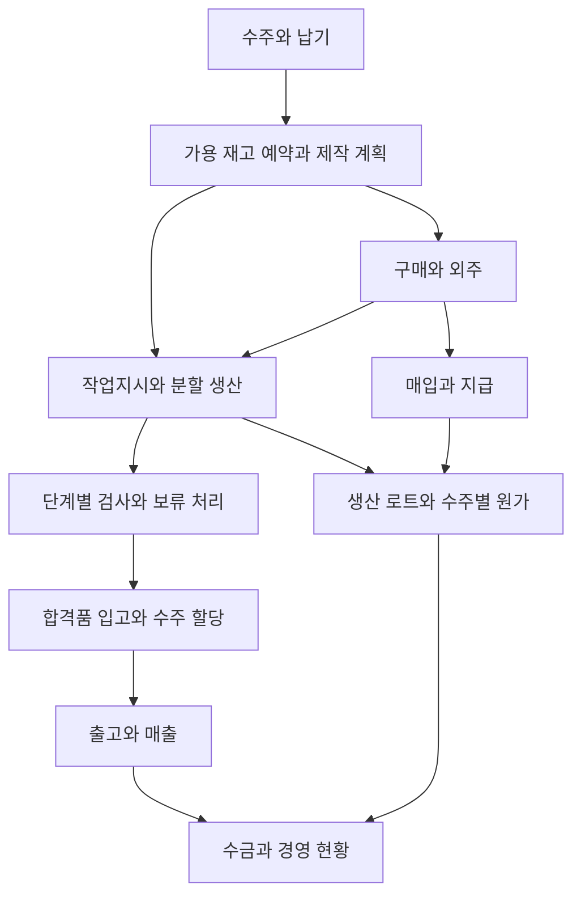

# TLC 맞춤형 통합 업무 프로그램 전체 개발 기획서

- 문서 버전: 검토 사항 반영안 1.2
- 작성일: 2026년 10월 19일
- 구축 방향: 회사 맞춤형 MES + ERP + AI
- 기술 방향: GitHub + Vercel + Firebase 기반, 업무 원장 DB·파일 저장소는 검증 후 확정, GPT API는 승인 자료에 한해 적용
- 목표: 착수 후 6개월 내 핵심 기능 개발과 제한된 현장 시범 운영
- 사용 환경: 개인 계정 PC·모바일, 조회 전용 대형 모니터
- 문서 상태: 부서별 기준 합의와 검증을 위한 전체 개발 기준안

> **수주부터 제작·검사·출고·매입·매출·원가까지 기록을 연결하여, 담당자에게 일일이 묻지 않아도 흐름과 문제를 확인할 수 있는 프로그램을 만든다.** 담당자는 자기 업무를 간단히 기록하고 다음 담당자는 그 기록을 재사용한다.

이 문서는 기능·화면·업무 규칙·데이터·보안·개발 일정·검증·정착 기준을 함께 정의한다. 예시의 수량·금액·장비 수는 실제 회사 데이터가 아니다. 기존 화면 샘플은 설명용이며 실제 서버·알림·회계 처리·장비 자동 연동의 구축 완료를 의미하지 않는다.

요구는 요청된 기능, 제안은 구현 기본안, 결정 필요는 회사 책임자의 합의가 필요한 기준이다. 수치 목표와 배부·회계·승인 정책은 확정 전까지 제안으로 관리한다.

## 목차

1. 구축 목적과 성공 기준
2. 전체 업무 흐름과 구축 범위
3. 참여자와 책임
4. 개발 전 업무 조사
5. 사용 화면과 디자인
6. 기준정보와 공통 기능
7. 수주·납기·주차별 출고 현황
8. 작업지시·모바일 알림·실적 입력
9. 공장·장비·작업자 관리
10. 구매·외주·소재·재고
11. 품질·부적합·재발 방지
12. 출고·거래명세서·출력물
13. 매입·매출·자금·원가
14. 거래처·평가 관리
15. 도면·성적서·사진·영상 관리
16. AI 적용 계획
17. 시스템 구조와 독립적인 기능 운영
18. 데이터 구조와 일관성
19. 권한·보안·기록 이력
20. 외부 연계와 데이터 이전
21. 개발·배포·장애 대응
22. 검증 시나리오와 완료 기준
23. 6개월 개발 일정
24. 비용과 운영 체계
25. 직원 참여와 현장 정착
26. 검토·결정 목록
27. 개발 착수 순서와 산출물
28. 용어와 기술 참고자료

## 1. 구축 목적과 성공 기준

### 1.1 해결할 문제

각 부서는 맡은 업무를 잘 수행하지만 엑셀, 이카운트, 개별 현황표 등에 정보가 나뉘어 있다. 다른 사람이 진행 상황을 확인하려면 담당자에게 물어야 한다. 프로그램은 기존 기록을 연결하여 다음 질문에 답해야 한다.

- 어느 거래처의 어떤 품번을 언제까지 몇 개 납품해야 하는가?
- 현재 어느 공장·장비에서 어떤 작업자가 몇 개를 만들고 있는가? (1인 다기종 및 무인 가공 포함)
- 소재 부족, 외주 지연(연속 외주 포함), 장비 고장, 품질 보류로 막힌 곳은 어디인가?
- 이번 주와 다음 주에 출고할 수량은 충분한가? (창고 여유 재고 포함 여부)
- 매입·매출·입금·지급은 얼마이며 수주별 직접 비용(예정/확정)과 예상 이익은 얼마인가?
- 누가 다음 일을 해야 하고, 어떤 승인된 최신 도면·자료를 확인해야 하는가?

### 1.2 성공 기준

화면이 완성되는 것만으로 구축 완료로 판단하지 않는다. **기록이 현장과 일치하고 다음 담당자가 실제로 활용하는 상태**를 목표로 한다.

| 확인 항목 | 측정 방법 | 초기 제안 기준 |
| --- | --- | --- |
| 업무 연결 | 시범 수주를 소재부터 출고·원가까지 추적 | 누락된 연결 없이 조회 (분할 진행·직송 포함) |
| 입력 정착 | 필수 기록의 기한 내 입력 비율 | 시범 운영 기준 95% 이상 목표, 조사 후 확정 |
| 수량 정확성 | 실사·작업일보·출고 기록 대조 | 승인 없는 차이 0건 |
| 사용 편의 | 실제 작업자의 대표 입력 시간 측정 | QR 스캔 활용 시 일반 실적 입력 15~30초 이내 목표 |
| 문의 감소 | 동일 업무의 진행 확인 문의 횟수 비교 | 착수 시 기준 측정 후 목표 결정 |
| 문제 발견 | 납기 위험·부적합·미확인 지시·적용 대상 도면 개정 관리 | 담당자·기한 표시, 적용 대상의 구버전 신규 작업 차단 |
| 지속 운영 | 복구·담당자 교체·장애 대응 훈련 | 회사 담당자가 매뉴얼로 수행 가능 |

## 2. 전체 업무 흐름과 구축 범위

### 2.1 업무 연결

수주·작업지시·생산 로트·소재·구성품·도면·장비·작업자·비용을 연결한다. 단품 가공과 조립품을 모두 지원하며 품목별로 필요한 공정만 적용한다. 부분 완료품의 후공정 이동과 외주처 간 직송도 실제 물량 흐름대로 기록한다.

### 2.2 단계별 범위

| 구분 | 포함 범위 |
| --- | --- |
| 6개월 핵심 범위 | 로그인·권한, 기준정보, 수주·가용재고 예약, 작업지시·QR·모바일 알림, 생산 실적·분할 진행·시간 분리, 장비 현황, 소재·사급·잔재·재고, 구매·외주 직송, 단계별 검사·부적합·재발 방지, 출고·거래명세서, 기본 매입·매출·수금·지급, 1단계 관리원가, 자료 관리, 전체 화면 현황판 |
| 제한 적용 | 실제 이카운트 양식으로 검증된 파일 이관, 선별 데이터 이전, 핵심 출력물, 거래처 평가 기초 집계 |
| 운영 오픈과 분리하여 적용 | 허용 자료의 AI 문서 입력·검색·요약 보조. 기본 업무 오픈 조건에 포함하지 않고 별도 검증 후 활성화 |
| 후속 확장 | 간접비 정밀 배부, 충분한 데이터 기반 업체 등급, 장비 자동 수집, 고급 일정 추천·예측, 사진 불량 판정, 복잡한 양방향 API 연계 |
| 별도 범위 합의 | 법정 회계 전체, 급여, 세무 신고, 전자세금계산서 직접 발행 연계, 고객·협력사 포털 |
| 이번 범위에서 제외 | 키오스크 및 공용 태블릿 전용 기능, 공용 기기에서의 사번·직원 QR 간편 전환 |

운영 화면은 **개인 계정으로 사용하는 PC·모바일과 조회 전용 대형 모니터**로 구성한다. 공용 기기 구매·설치·운영 절차는 본 일정과 비용에서 제외한다.

6개월은 핵심 기능 개발과 제한된 현장 시범 운영 목표다. 새로운 기능을 추가할 때 기간·비용·검증 영향을 검토한다. 수량·품질·금액 정확성은 범위를 줄이더라도 유지한다.

## 3. 참여자와 책임

부서명은 실제 조직에 맞춰 정한다. 별도 구매팀 신설을 전제로 하지 않으며, 구매 업무는 지정된 기존 담당자가 수행한다.

| 참여자 | 책임 | 주로 보는 화면 |
| --- | --- | --- |
| 대표·임원 | 목표와 우선순위 결정, 참여 시간·예산 확보, 월별 장애물 해결 | 통합 흐름, 납기 위험, 비용·원가·수익 |
| 프로젝트 책임자 | 범위·일정·결정 관리, 부서 간 기준 조정 | 개발 일정, 미결정 사항, 검증 결과 |
| 영업·수주 담당 | 거래처·품번·수량·납기·변경 이력 | 수주와 주차별 출고 |
| 생산관리·권한 있는 팀장 | 공정 계획, 장비·작업자 배정, 작업지시 발행 | 제작 계획, 지시 확인, 지연 현황 |
| 현장 작업자 | 지시 확인, 시작·중단·실적·이상 기록 | 내 작업, 도면, 간편 입력 |
| 자재·구매·외주 업무 담당 | 발주·입고·외주 반출입·소재 이동 | 부족 자재, 발주 잔량, 재고 |
| 품질 담당 | 검사, 보류, 처분 승인, 재발 방지 확인 | 검사 대기, 부적합, 조치 기한 |
| 출고 담당 | 출고 가능 수량 확인, 실제 출고 확정 | 출고 예정, 납품 자료 |
| 경리·원가 담당 | 매입·매출·입금·지급·원가 기준 및 마감 | 채권·채무, 원가, 마감 |
| 시스템 관리자 | 계정·권한·설정·운영 장애 관리 | 관리 화면, 오류·백업 현황 |

시스템 관리 권한이 모든 원가·매출 자료 열람 권한을 자동으로 포함하지 않게 설계한다. 중요 확정과 취소 권한은 별도로 부여한다.

프로젝트 책임자와 부서별 대표 사용자를 착수 시 지정한다. 대표·임원은 월별 의사결정, 팀장은 주간 개선 사항 확인, 직원은 실제 사례 검증에 참여한다. 개발 전담 인력과 운영 인수 담당자도 명확히 지정한다.

## 4. 개발 전 업무 조사

### 4.1 수집할 자료

실제 완료 수주와 진행 중 수주를 각각 선정하고, 정상 사례 외에 긴급 변경·부분 납품·재작업·외주 불량 사례를 포함한다.

- 수주서, 견적서, 거래처 품번, 사내 품번, 조립 구성표, 공정표
- 작업지시서, 작업일보, 장비 현황표, 교대·인수인계 기록
- 구매·외주 발주서, 입고표, 소재 관리대장, 재고 조사표
- 도면과 개정 이력, 소재 성적서, 검사 성적서, 부적합 보고서
- 거래명세서, 매입·매출 내역, 수금·지급·미수·미지급 내역
- 원가 계산표, 시간 단가, 간접비 기준, 기존 엑셀과 이카운트 사용 양식
- 파일 저장 위치, FTP 사용 방식, 자료 열람 권한과 보관 규정

### 4.2 각 업무에서 확인할 질문

| 조사 항목 | 반드시 답할 내용 |
| --- | --- |
| 담당 | 누가 작성하고 누가 확인·승인하는가? |
| 시작 조건 | 어떤 요청이나 자료를 받으면 일이 시작되는가? |
| 입력 | 무엇을 언제 어디서 기록하는가? 이미 다른 곳에 있는 값인가? |
| 결과 | 다음 담당자가 어떤 결과와 자료를 받아야 하는가? |
| 예외 | 수량·납기·도면 변경, 반품, 불량, 장비 고장 시 어떻게 처리하는가? |
| 확정 | 언제 수정이 제한되며 누가 취소·정정할 수 있는가? |
| 불편 | 반복 입력, 찾기 어려운 자료, 전화 확인은 무엇인가? |

조사 결과는 업무 흐름도, 입력 항목 사전, 자료 목록, 승인 기준, 예외 목록, 현장 검증 사례로 남긴다. 직원·팀장 확인 없이 개발자의 추정만으로 업무를 확정하지 않는다.

### 4.3 반드시 조사할 예외 사례

분할 생산, 여유 생산품 재사용, 반제품 후속 공정, 긴급 도면 변경, 1인 다기종·무인 가공, 초품 소모, 원소재 절단·잔재, 유상·무상 사급, 연속 외주 직송, 부분 합격, 월말 단가 정산, 반품·취소 사례를 각각 확보한다. 고객별 소재·도면·자료 외부 전송 조건도 확인한다.

현재 이카운트 계정에서 실제로 사용하는 가져오기·내보내기 양식과 성공·실패 결과를 확보한다. 소개 자료만으로 연계 가능 범위를 확정하지 않는다.

## 5. 사용 화면과 디자인

### 5.1 공통 디자인

- PC는 밝은 배경, 짙은 남색 메뉴, 청록색 주요 버튼을 기본 제안으로 한다.
- 현장·모바일은 큰 글자와 버튼, 한 화면에 한 가지 행동을 중심으로 구성한다.
- 정상·주의·문제는 색상과 함께 한글 상태명을 표시한다.
- 납기, 수량, 장비, 담당자를 같은 위치에 배치하여 화면을 바꿔도 익숙하게 만든다.
- 검색 조건을 유지하고 즐겨찾기·최근 사용 항목을 제공한다.
- 필수 입력만 먼저 보이고 추가 항목은 펼쳐 입력한다.
- 오류는 잘못된 칸 바로 옆에 수정 방법과 함께 표시한다.
- PC 입력은 키보드 이동·복사·붙여넣기를 지원하고 모바일에는 맞는 숫자 키패드를 사용한다.
- 현황판과 출력물에는 기준 시각, 단위, 필터 조건을 명확히 표시한다.

### 5.2 화면 목록

| 화면 | 현황판·조회 | 입력 | 출력·후속 행동 |
| --- | --- | --- | --- |
| 통합 메인 | 오늘 납기, 위험 수주, 장비, 품질 보류, 내 할 일 | 업무별 빠른 등록 | 해당 문제 화면으로 이동 |
| 수주·납기 | 업체·품번·총수량·주차별 예정/실출고 | 수주·납기 변경 | 수주 현황, 일정표 |
| 생산·작업지시 | 공정별 진행, 지시 확인, 계획 대비 실적 | 계획·배정·발행 | 작업지시서, 공정 추적 |
| 장비 | 공장별 장비와 현재 작업·작업자 | 상태 변경·고장·이동 | 가동·중단 이력 |
| 구매·외주 | 발주·입고·반출·회수 잔량 | 간편 품목표 입력 | 발주서, 외주 지시서 |
| 소재·재고 | 가용·예약·검사 대기·보류 | 입출고·이동·실사 | 소재 대장, 로트 추적 |
| 품질 | 검사 대기, 부적합 유형, 조치 기한 | 검사·불량·사진·처분 | 검사 성적서, 부적합 보고서 |
| 출고 | 출고 예정·가능·실적 | 출고·반품 | 거래명세서, 출고표 |
| 매입·매출·원가 | 미수·미지급·수주별 비용 | 전표·수금·지급·조정 | 원가표, 채권·채무 내역 |
| 거래처 | 기본정보·평가·주의 사항 | 업체·평가·개선 요청 | 평가표 |
| 자료 | 도면·성적서·사진·영상 | 업로드·개정·승인 | 권한 있는 보기·다운로드 |
| AI 도우미 | 질문, 요약, 입력 제안 | 질문·자료 선택 | 출처 확인, 제안 승인 |
| 모바일 내 작업 | 받은 지시·진행·대기·알림 | 확인·시작·중단·실적·이상 | 도면 확인, 이력 조회 |

### 5.3 대형 모니터

상단에 업체·품번·총수량·납기 위험을, 본문에 수주부터 출고까지의 간트차트를 표시한다. 계획과 실제 기간을 구분하며 공정별 진행량과 보류 사유를 함께 표시한다. 행을 선택하면 관련 작업·장비·품질 문제로 연결한다.

별도 화면에서 공장별 장비 배치와 상태, 현재 가공품·담당자·완료 예상 시각을 보여준다. 전체 화면에서는 메뉴·입력 버튼을 숨기고 차트만 표시한다. 수동 전환과 자동 순환을 지원하며 마지막 갱신 시각과 연결 상태를 항상 노출한다.

모니터 전용 계정은 조회만 가능하다. 매출 단가·원가·개인별 민감한 정보는 현장 공개 화면에서 제외한다.

### 5.4 개인 모바일 QR 입력

작업지시서, 소재·재공·완제품 현품표, 외주 이동표에 고유 QR을 인쇄한다. 개인 모바일 카메라 또는 PC에 연결된 스캐너로 해당 업무를 연다. **QR은 대상을 찾는 수단이며 로그인이나 작업 권한을 대신하지 않는다.**

QR에는 민감한 단가·원가·도면 주소·인증정보를 넣지 않는다. 조회 시 서버가 현재 사용자 권한과 대상의 취소·개정 상태를 검사한다. 재출력과 라벨 훼손에 대비하고, 분할 로트는 새 라벨을 발행하여 현품을 구분한다.

휴대전화 미소지·장갑·절삭유 등으로 즉시 입력하기 어려운 공정은 지정된 PC 입력 위치와 기록 시점을 현장 조사에서 정한다. 대리 입력이 필요한 경우 실제 작업자·입력자·발생 시각·대리 사유를 구분한다. 공용 태블릿 전용 화면은 개발하지 않는다.

현장 알림은 눈에 띄는 고정 색상·아이콘·한글 상태로 강조한다. 지속적인 배경 점멸은 기본 방식으로 사용하지 않는다.

## 6. 기준정보와 공통 기능

### 6.1 기준정보

회사, 공장, 창고, 위치, 장비, 직원, 역할, 거래처, 품목, 소재 규격, 단위, 공정, 불량 유형, 중단 사유, 세금 구분, 비용 항목, 승인 경로를 관리한다.

품목에는 사내 품번과 거래처 품번을 구분한다. 조립 구성표와 공정표는 개정 번호를 두고 작업지시에는 당시 승인된 버전을 고정한다. 신규 개정이 과거 작업 기록을 자동으로 바꾸지 않도록 한다.

사용한 기준정보는 삭제 대신 사용 중지한다. 공장·장비·작업자의 이동과 소속 변경은 적용일과 이력을 보관한다. 모든 수주·지시·출고·부적합에 고유 번호를 부여한다.

### 6.2 공통 처리

조회·필터·엑셀 내보내기, 임시 저장, 첨부파일, 변경 이력, 승인·반려, 알림, 일괄 등록 검증, 문서 인쇄를 공통으로 제공한다. 일괄 작업도 행별 성공·실패 결과와 실패 이유를 남긴다.

### 6.3 추가 기준정보

거래처·품목·문서별 외부 AI 전송 허용 정책, 유효 잔재 최소 규격, 초품·시험 소모 구분, 근무 달력·휴일·교대, 공정별 기준 시간, 장비 가능 공정, 검사 단계별 해제 조건을 관리한다. AI 정책이 미분류된 자료는 승인 전 외부 전송을 금지한다.

## 7. 수주·납기·주차별 출고 현황

### 7.1 수주와 변경

수주번호, 거래처와 주문번호, 사내·고객 품번, 품명, 적용 도면 개정, 수량·단위, 수주일, 최초·현재 약속 납기, 주차별 납품 계획, 납품 장소, 담당자, 특이사항을 입력한다. 가격은 별도 권한으로 관리한다.

수량·납기·도면 변경은 사유와 승인·고객 합의 자료를 남긴다. 수주 취소·감량 시 예약 재고 해제, 진행품의 보류·재고 전환·폐기, 외주 취소 비용, 출고·매출 정정을 각각 확인한다. 이미 일어난 거래를 수주 삭제로 없애지 않는다.

### 7.2 기존 재고 예약과 반제품 활용

기존 재고는 품번·도면뿐 아니라 소재 규격·로트 추적·검사 상태·고객 제한·소유권을 확인한 뒤 예약한다. 같은 수량을 여러 수주에 중복 예약하지 못하도록 서버가 검증한다. 예약 이동·해제에는 권한과 사유를 남긴다.

완제품을 예약하면 신규 완제품 생산 필요량을 줄일 수 있다. **반제품을 예약하면 완료된 공정은 제외하고 남은 공정을 계획**한다. 완제품 20개와 중간 공정품 20개를 같은 출고 가능 수량으로 보지 않는다.

### 7.3 여유 생산과 합격품 입고

수주 수량과 생산 지시 수량을 분리하고, 여유 생산의 수량·사유·승인자를 기록한다. 수주 100개에 기존 완제품 20개를 예약하고 신규 85개를 지시하는 경우 신규로 충당할 수주 잔량은 80개다.

신규 생산품은 검사·입고 조건을 충족할 때 실제 로트로 한 번만 입고한다. 그중 수주에 필요한 수량은 예약하고 여유 수량은 사용 조건을 확인하여 가용 재고로 남긴다. 출고 후 남았다는 이유로 같은 실물을 다시 입고하지 않는다.

사급 소재로 만든 잔여 제품은 자사 소유 완제품으로 자동 전환하지 않는다. 고객 소유·사용 제한을 유지하며 반납 또는 다른 주문 전용에 필요한 승인을 기록한다. 여유 재고가 다음 수주로 이동할 때 관련 원가도 승인된 방식으로 연결한다.

### 7.4 현황판 지표

| 항목 | 의미 |
| --- | --- |
| 수주 총수량 | 현재 승인된 납품 요구량 |
| 기할당 완제품 | 조건을 충족하고 해당 수주에 예약한 완제품 |
| 할당 반제품 | 후속 공정이 남은 예약품, 완제품과 분리 |
| 주차별 예정·실출고 | 약속 납품 수량과 실제 확정 출고 수량 |
| 출고 가능 | 해당 수주에 사용 가능하고 최종 검사·필수 공정·자료·보류 조건을 모두 통과한 물량 |
| 제작 중 | 현재 공정 위치에 있는 물량, 분할 이동 중복 제외 |
| 보류·검사 대기 | 이유와 해제 조건이 있는 별도 수량 |
| 여유 재고 | 해당 수주 요구를 초과한 재고, 수주 진척률에서 분리 |
| 폐기·반품 | 정상 재공·출고와 분리한 이동·처분 이력 |
| 납기 위험 | 잔여 공정·자재·장비·외주·검사를 고려한 위험 |

주차의 시작일과 휴일 기준을 정하고 계획·실적을 같은 기준으로 집계한다. 제작 완료율과 출고율을 분리하며 주차 합계, 변경 수주 수량, 예약·실출고가 맞는지 검증한다.

### 7.5 예상 완료일과 간트차트

근무 달력, 장비 사용 가능 시간, 공정별 기준 시간·세팅 시간, 대기 순서, 외주 약속일, 검사 소요를 사용한다. 초기에는 설명 가능한 규칙으로 계산하고 팀장이 사유를 남겨 조정할 수 있게 한다. 정보가 부족하면 추정 또는 계산 불가로 표시한다.

공정별 계획·실제 기간, 담당자·장비, 잔량·보류를 보여주고 영향받는 수주를 연결한다. 입력 기반 현황의 마지막 갱신 시각을 표시한다. 기한이 지나지 않은 이번 주 미출고를 무조건 지연으로 처리하지 않는다.

## 8. 작업지시·모바일 알림·실적 입력

### 8.1 지시 발행 절차

1. 생산관리 담당자 또는 권한 있는 팀장이 수주·품번을 선택한다.
2. 예약 완제품·반제품과 현재 공정을 확인하여 실제 필요한 공정·수량을 계산한다.
3. 공장·장비·작업자·시작 예정·완료 기한·우선순위·여유 수량을 지정한다.
4. 해당 수주에 적용되는 승인 도면·구성표·공정표·검사 기준 버전을 확인한다.
5. 소재·선행 공정 이관량·장비 수리·일정 충돌을 확인한다.
6. 발행하면 내부 알림함과 푸시 발송 작업을 등록하고 QR 작업지시서를 출력할 수 있다.
7. 지시자는 미확인·확인·작업·중단·부분 이관·완료를 추적한다.

준비 조건별로 차단 또는 경고 기준을 정한다. 예외 발행은 권한·사유를 남기며 품질 보류품 사용 금지 등 필수 제한은 우회하지 않는다.

### 8.2 도면 개정의 적용과 보류

도면 업로드, 승인, 작업 적용은 별도 단계다. 승인된 최신 도면이 모든 과거·진행 주문에 자동 적용되는 것은 아니다. 개정 시 적용 대상 수주·로트·작업지시·시점과 기존 제작품의 처리 방식을 지정한다.

| 상황 | 처리 |
| --- | --- |
| 다음 주문부터 적용 | 기존 승인 작업은 지정 버전 유지, 신규 대상만 변경 |
| 진행품에 즉시 적용 | 영향받는 지시·로트 보류, 생산·품질 담당에게 통보 |
| 기존품 사용 허용 | 권한자 승인 및 필요한 고객 합의 근거 보관 |
| 재작업·재검사 필요 | 별도 지시와 검사 조건을 연결 |

보류 중에는 신규 작업 시작·재개·다음 공정 이관·출고를 제한한다. **이미 수행한 실적, 중단 시각, 불량·이상 사실의 기록은 허용**하며 보류 이전 발생인지 사후 입력인지 구분한다. 이를 이용해 보류품을 정상 가용 재고로 바꿀 수는 없다.

재개는 영향 검토와 처분 승인, 유효 작업 버전 반영, 작업자의 변경 내용 열람·명시적 재확인 후 허용한다. 구버전은 현장 기본 사용에서 제외하되 과거 기록 조회에는 ‘사용 중지·이력용’ 표시로 보존한다.

초기 시스템의 보류는 프로그램상 업무 통제다. 장비 신호 연동 전에는 실제 장비를 자동 정지시키지 못하므로 책임자의 현장 중지 전달과 확인 절차를 둔다.

### 8.3 개인 모바일 작업 흐름

작업자는 개인 계정으로 로그인하여 알림 또는 작업 QR로 진입한다. **지시 확인 → 실제 시작 → 중단·실적 입력 → 완료** 순서로 조작한다. 지시 확인과 작업 시작은 별도 버튼이다. 품번·수주·장비는 지시에서 불러오고 양품·불량·소모·사유 등 필요한 값만 입력한다.

| 상태 | 뜻 |
| --- | --- |
| 작성 중 | 발행 전 초안 |
| 발행·미확인 | 유효 지시가 내부 알림함에 등록됨 |
| 열람 | 작업자가 해당 버전 화면을 열었음 |
| 확인 완료 | 작업자가 해당 버전을 명시적으로 접수함 |
| 작업 중 | 실제 작업 시작 기록이 있음 |
| 중단 | 작업 사유에 따른 일시 중단 |
| 보류 | 품질·도면 등 해제 승인이 필요한 제한 |
| 완료 | 잔량과 필수 처리 조건 검증 후 종료 |
| 취소 | 승인된 취소와 잔여 물량 처리 완료 |

부분 완료·이관은 단일 상태로 작업을 덮어쓰지 않고 별도 수량으로 표시한다. 동일 지시에서 일부는 다음 공정, 일부는 작업 중, 일부는 보류일 수 있다.

### 8.4 알림과 확인

FCM 웹 푸시와 내부 알림함을 사용한다. HTTPS, 사용자 알림 허용, 지원 브라우저·서비스 워커 설정이 필요하며 iPhone의 홈 화면 웹 앱 지원 조건은 실제 기기로 검증한다. 소리·진동·즉시 도착은 기기 설정과 통신 환경의 영향을 받는다.

푸시 발송 요청 성공, 실제 기기 전달, 열람, 지시 확인, 실제 시작을 구분한다. 확인할 수 없는 전달 상태를 수신 완료로 표시하지 않는다. 푸시 미허용·오프라인 상태라도 재접속 후 알림함에서 유효 지시를 확인할 수 있다.

미확인 시간·재알림 횟수·근무시간·긴급 지시 기준을 정한다. 장기 미확인은 지시자와 대형 모니터에 표시하고 현장 전달·확인으로 보완한다. QR 출력물 자체는 알림 수신 확인을 대신하지 않는다.

담당자 변경·취소·도면 개정 시 새 알림에 변경 내용과 버전을 포함한다. 퇴사·로그아웃 시 계정과 기기 알림 연결을 해제한다. 재시도 중복 발송을 제한하고 실패 작업을 운영 화면에 남긴다. 잠금 화면에는 민감한 고객·도면 정보 노출을 제한한다.

### 8.5 작업자 시간과 장비 시간

장비별 세팅·유인 가공·무인 가공·중단 시간을 구분하고 작업자 직접 투입 시간과 별도로 기록한다. 세팅을 포함한 점유 시간과 실제 가공 시간을 다른 지표로 표시한다.

작업자 1명이 장비 3대를 8시간 운영해도 장비 시간 합계 24시간을 개인 노무 24시간으로 계산하지 않는다. 직접 기록을 원칙으로 하되 간편 배분이 필요하면 동시 작업 구간별 비율·가중치를 정하고 ‘배분 추정’으로 표시한다. 단순 1/N 배분은 동등한 투입을 가정하는 경우에만 사용한다.

휴게·교대·세팅·측정·무인 가동을 고려하고 개인별 배분 시간의 중복·근무시간 초과를 검증한다. 야간 무인 가동은 예상 종료와 실제 확인 시각을 구분하며 입력만으로 실제 가동을 확정 측정했다고 설명하지 않는다.

### 8.6 초품 소모와 분할 진행

예정된 세팅·시험 소모와 공정 부적합을 분리한다. 개인 과실은 조사 없이 자동 지정하지 않는다. 초품 소모도 재고·수율·원가에 포함하고 일반 공정 불량과 별도로 집계한다. 소모 사유·허용 기준을 관리하여 불량을 초품 소모로 바꾸어 숨기지 못하게 한다.

지시 50개 중 30개를 다음 공정으로 이관할 때 부모·자식 로트, 현재 위치, 수량, 완료 공정, 검사 상태, 누적 원가를 연결한다. 잔여 20개는 원공정에 남는다. 단순 분할로 물량이나 비용이 새로 생기지 않도록 한다. 합치기가 필요한 경우 품번·개정·소유·검사 상태를 확인하고 원래 로트 계보를 유지한다.

교대는 전임 종료, 잔량·주의사항, 후임 접수를 기록한다. 실적 정정·지시 취소는 이미 발생한 재고·외주·검사에 미치는 영향까지 확인한다.

## 9. 공장·장비·작업자 관리

공장은 추가·변경·사용 중지할 수 있다. 1공장 20대, 2공장 40대 같은 구성은 예시이며 프로그램에 고정하지 않는다. 장비 이동은 이전·이후 공장, 위치, 적용 시각, 사유를 기록한다. 과거 실적의 공장 정보는 당시 기준으로 보존한다.

장비 상태는 가동, 준비·세팅, 대기, 수리, 비가동으로 구분한다. 비가동 사유는 계획 정지·작업 없음·고장 등으로 세분한다. 상태 미입력이나 통신 끊김을 비가동으로 단정하지 않고 ‘정보 갱신 필요’로 표시한다.

장비 상세 화면에는 현재 품번, 수주·작업지시, 공정, 작업자, 지시·완료·잔량, 시작 시각, 중단 사유, 문제 사진, 수리 이력을 표시한다. 수리 중 장비의 신규 배정 제한 기준을 정한다.

초기에는 작업자의 시작·중단·완료 입력을 기준으로 상태를 갱신한다. 센서·설비 연동은 장비별 통신 가능 여부, 비용, 데이터 신뢰도를 조사한 뒤 확장한다. 입력 기반 현황을 센서 기반 실시간 자동 측정으로 설명하지 않는다.

가동률은 계획 가동 시간과 실제 가동 시간의 정의를 먼저 확정한다. 휴일·휴게·세팅 포함 여부가 다른 지표를 섞어 비교하지 않는다.

유인 가동과 무인 자동 가동을 구분하고 장비별 가능한 공정, 계획 정비, 점검·수리 담당자, 예상 복구일을 기록한다. 장비 수리 상태와 작업 배정 제한을 연결한다. 여러 장비를 운영하는 작업자의 현재 담당 장비 목록과 각 장비 실제 작업 지시를 함께 표시한다.

## 10. 구매·외주·소재·재고

### 10.1 구매와 간편 입력

구매 요청 → 승인 → 발주 → 부분 입고 → 수입 검사 → 가용 재고 → 매입 확인으로 연결한다. 간소화 경로는 금액·품목별 권한 기준으로 정한다.

상단에는 거래처·일자·납기·창고, 하단에는 품목·규격·수량·단가·공급가액·세액·합계를 배치한다. 최근 거래·기존 발주 복사, 품목 자동 완성, 엑셀 붙여넣기와 행별 오류·중복 확인을 제공한다.

부분 입고·미입고 잔량·과입고 허용·반품·취소·단가 변경을 지원한다. 발주, 실물 입고, 검사 합격, 매입 금액 확정은 각각의 상태로 관리한다.

### 10.2 외주와 직송

업체·공정·반출 로트·소유·수량·납기·단가·지급 소재를 등록한다. 회수 시 양품·불량·미회수·손실·잔재·추가 비용을 원지시와 연결한다.

외주 직송은 **A업체 발송 → 이동 중 → B업체 수령 확인 → 차이 처리 → 후속 공정 착수**로 기록한다. 발송·수령 시각, 담당자, 수량, 운송·성적서 증빙을 보관한다. A업체의 발송을 B업체의 수령으로 자동 확정하지 않는다. 별도의 외부 포털 없이도 내부 담당자가 업체 확인 근거를 첨부해 기록할 수 있다.

부족·분실·파손은 차이 사건으로 등록하고 실제 위치를 유지한다. 허위 사내 입출고는 만들지 않는다. 외주비 발생·검수·금액 확정은 각각의 기준으로 처리한다.

직송 전 필요한 검사 항목과 승인자를 지정한다. 다음 공정 후 확인할 수 없는 특성은 직송 전에 검사한다. 출하 성적서·사진 확인으로 대체할 수 있는 항목만 승인된 조건부 이관을 허용하며 최종 출고 합격과 구분한다.

### 10.3 재고의 상태와 소유

품목·규격·로트·부모 로트·소유자·위치·관리 단위·성적서·검사 상태를 관리한다. 현재고, 예약, 검사 대기, 보류, 가용, 이동 중을 구분한다. 공장 간 이동과 외주 이동 모두 발송·수령 차이를 처리할 수 있어야 한다.

재고는 입고·불출·투입·반납·이동·폐기·조정 이력으로 계산한다. 직접 수량을 덮어쓰지 않으며 실사 차이는 승인 조정으로 남긴다. 품목별 단위 환산·소수 자릿수·허용 오차를 정한다.

### 10.4 원소재 절단과 잔재 수량 보존

원소재를 작업에 불출한 뒤 사용량·잔재 반납량·손실량으로 나눈다. 불출은 창고에서 작업 위치로 이동하는 것이며 사용과 동일한 비용 발생으로 중복 계산하지 않는다.

> 작업 종료 시 불출량 = 실제 사용량 + 재사용 잔재 반납량 + 손실량

진행 중에는 미처리 작업 잔량을 추가하여 대조한다. 1,000mm 불출 후 600mm 사용, 잔재 390mm, 절단 손실 10mm라면 합계가 1,000mm로 일치해야 한다. 원소재에 잔량을 남긴 채 같은 잔재를 새 입고로 추가하지 않는다.

현장은 기준 크기 이상의 유효 잔재만 길이·규격 등 최소 항목으로 등록한다. 부모 로트·성적서·소유를 상속하고 QR 현품표를 발행한다. 표준 소요와 손실 계산을 입력 보조로 사용할 수 있지만 실제 확정값과 차이를 구분한다. 월말 실사는 예외 차이 정정이며 일상 수량 보존을 대신하지 않는다.

### 10.5 유상·무상 사급

무상 사급은 수량·로트·위치·고객 소유를 추적하고 자사 재료 구입비는 0으로 구분한다. 가공·외주·작업 비용은 별도로 발생한다. 당사 귀책 변상은 승인된 금액과 원거래를 연결하며 고객 대금 차감 처리와 비용을 중복 반영하지 않는다.

유상 사급은 계약의 소유권·정산·사용 제한을 확인한 뒤 매입·원가 기준을 정한다. 명칭만으로 일반 소재와 완전히 같은 거래로 가정하지 않는다. 남은 사급 소재·재공·완제품은 반납 또는 전용 승인까지 추적한다.

### 10.6 조립품 구성 추적

승인된 구성표 버전과 실제 투입한 구성품 로트·수량을 완제품 로트에 연결한다. 필요 제품만 개별 일련번호 관리 대상으로 정한다. 구성품 대체·추가·반납·분해는 승인과 변경 이력을 남긴다. 특정 소재나 부품의 부적합이 발견되면 관련 재공·완제품·출고 거래처까지 역추적할 수 있어야 한다.

## 11. 품질·부적합·재발 방지

### 11.1 검사

수입 검사, 공정 검사, 최종 검사를 구분한다. 검사 기준 버전, 측정 항목, 기준값·허용 범위, 측정값, 검사 수량, 판정, 검사자, 측정기, 검사일, 첨부를 기록한다. 측정기 교정 유효기간 관리의 상세 범위는 품질 담당과 합의한다.

검사 성적서는 승인된 기록으로 생성한다. 누락 측정값을 자동으로 합격값으로 채우지 않는다. 수정·재검사 이력을 남긴다.

### 11.2 검사 단계별 해제와 부분 합격

수입 검사 합격은 소재 사용을, 공정 검사 합격은 다음 공정 진행을 허용한다. **최종 검사 합격만으로 출고를 확정하지 않으며 필수 공정·자료·수주 사용 조건·보류 여부를 함께 확인**한다.

부분 합격은 현품을 합격·보류 수량으로 구분할 수 있을 때 적용한다. 50개 중 45개 합격·5개 보류라면 각각의 로트 또는 식별 라벨과 위치를 남긴다. 표본 검사 결과를 전체 개별 합격 수량으로 임의 환산하지 않는다. 검사 방식·표본 수·판정 기준을 품질 담당자가 정한다.

### 11.3 부적합 처리 흐름

발견 → 등록 → 대상 수량·위치 격리 → 원인 조사 → 처분 승인 → 실행 → 재검사 → 제품 처리 종료로 진행한다. 별도로 재발 방지 조치와 효과 확인을 추적한다.

| 필수 기록 | 내용 |
| --- | --- |
| 발생 위치 | 수주·품번·로트·공정·장비·작업지시 |
| 현상 | 불량 유형, 발견 내용, 수량, 사진·측정값 |
| 영향 | 재고·진행품·출고품 중 관련 범위 |
| 격리 | 실제 보관 위치, 사용·출고 차단 상태 |
| 원인 | 조사 내용과 근거, 미확정 여부 |
| 처분 | 재작업·수리·반품·폐기·조건부 사용 등 승인된 방식 |
| 책임과 기한 | 조치 담당자, 승인자, 예정일 |
| 비용 | 추가 자재·시간·외주·폐기 손실의 연결 |
| 효과 확인 | 재발 방지 실행, 확인 기간, 결과, 재발 여부 |

조건부 사용은 고객 요구와 승인 권한을 확인하며 일반 사용자나 AI가 승인하지 못한다. 보류품을 현황에서만 표시하고 실제 사용·출고는 허용하는 구조로 만들지 않는다.

불량 유형은 선택 목록과 상세 메모를 함께 사용한다. ‘발견 현상’과 ‘확인된 원인’을 구분한다. 제품 처리 완료와 재발 방지 효과 확인 완료는 서로 다른 종료 상태다.

### 11.4 재발 방지 기능

동일 품번·공정·장비에서 있었던 부적합을 새 지시에서 확인할 수 있게 한다. 승인된 주의사항을 작업지시와 검사 항목에 연결한다. 반복 발생, 미완료 조치, 기한 초과를 담당자별로 표시한다. 단순 건수뿐 아니라 생산량 대비 불량률과 손실 비용도 보되 집계 기간·분모를 명확히 한다.

## 12. 출고·거래명세서·출력물

출고 담당자는 수주별 약속 납기, 출고 가능 수량, 검사 상태, 필수 성적서 유무를 확인한다. 부분 출고를 지원하고 출고 확정 시 재고 변동 및 수주 실적에 반영한다. 출고와 매출 인식 시점은 회사 회계 기준에 따라 별도로 연결한다.

거래명세서는 거래처·공급자 정보, 날짜·문서번호, 품목·규격·수량·단가·공급가액·세액·합계, 비고를 제공한다. 상단 기본정보와 하단 품목표로 구성해 익숙하고 간결하게 출력한다. 실제 로고·직인·사업자 정보는 확인된 자료만 사용한다.

발주서, 외주 발주서, 작업지시서, 입고표, 소재 대장, 검사 성적서, 부적합 보고서, 거래명세서, 출고표, 수주 원가표를 우선 출력 대상으로 한다. 미확정 문서는 ‘미확정’ 표시를 넣고 재출력에는 같은 문서번호와 개정 상태를 유지한다.

반품은 원출고와 연결해 입고 상태·검사·환입 매출 처리 여부를 구분한다. 출고 취소가 이미 확정된 매출·수금에 영향을 주면 관련 정정 절차를 안내한다.

### 12.1 출고 가능 조건과 반품

출고는 최종 합격, 필수 공정 완료, 필수 성적서 확보, 수주에 사용 가능한 소유·개정·고객 조건, 보류 없음, 출고 잔량 검증을 모두 통과해야 한다. 출고 가능 여부와 출고 확정은 별도다.

반품은 원출고·로트·사유·수량을 연결하고 우선 반품 검사 대기로 입고한다. 자동 가용 재고 전환을 금지한다. 재검사·재작업·폐기·재출고와 매출·채권 정정을 각각 연결한다. 여유 양품은 생산 입고 때 생성된 재고를 그대로 유지하고 출고 후 중복 입고하지 않는다.

## 13. 매입·매출·자금·원가

### 13.1 금액과 시점의 구분

수주 금액은 계약 금액, 매출은 회사가 정한 기준의 확정 판매액, 수금은 실제 받은 돈이다. 발주·입고·매입 확정·지급도 서로 다른 사건이다. 출고했다고 세금계산서나 회계 전표가 자동 확정된 것으로 표시하지 않는다.

공급가액·세액·합계·통화와 인식 기준일을 구분한다. 월말 증빙 도착 전에도 승인된 임시 단가로 발생 비용을 추정할 수 있다. 다만 매입 증빙이 도착했다는 이유만으로 수주 전체의 모든 원가가 실제 금액으로 확정됐다고 표시하지 않는다.

### 13.2 관리원가 표시

| 지표 | 의미 |
| --- | --- |
| 견적·계획 원가 | 수주 판단과 생산 계획에 사용한 예상 비용 |
| 현재까지 발생 원가 | 기록된 자재 사용·외주·작업 등 현재 발생분, 임시 단가 포함 여부 표시 |
| 잔여 예상 원가 | 미완료 공정에 앞으로 필요할 것으로 보는 비용 |
| 완료 예상 원가 | 현재까지 발생 원가 + 잔여 예상 원가 |
| 마감 관리원가 | 승인된 거래 금액·작업 시간·기준 단가·배부 규칙으로 마감한 비용 |

비용 항목마다 임시 단가·확정 거래액·표준 시간 단가·추정 배분 여부를 표시한다. 실제 노무비가 아니라 표준 임률로 계산한 경우 마감 후에도 그 계산 성격을 유지한다. 원가 비교는 같은 비용 범위를 기준으로 한다.

### 13.3 1단계 비용 범위와 2단계 확장

| 항목 | 계산 방향 | 중복 방지 기준 |
| --- | --- | --- |
| 직접 재료비 | 실제 사용량 × 적용 소재 원가 | 불출·사용 중복 금지, 잔재 반납·소유 반영 |
| 외주비 | 해당 생산 로트·수주에 귀속한 비용 | 직송·재작업·정산 차이 연결 |
| 직접 작업비 | 승인된 직접·배분 시간 × 표준 임률 | 개인 시간 중복·무인 가동 인건비 과대 방지 |
| 장비 기준 비용 | 승인 가동·세팅 시간 × 기준 단가 | 단가에 포함된 전력·감가 등 명시 |
| 추가 손실 | 추가 자재·외주·변상 등 | 다른 원가 항목에 포함된 금액 재합산 금지 |

1단계는 위 범위의 관리원가를 제공한다. 장비비가 표준 배부 성격이면 직접 비용과 구분하여 표시한다. 2단계의 간접비 정밀 배부를 적용할 때 장비 단가에 이미 포함한 항목을 다시 더하지 않는다. 불량 손실 분석 화면은 기존 원가를 분류해 보여줄 수 있으며 그 금액을 원가 합계에 중복 가산하지 않는다.

### 13.4 여유품·분할품·재사용 재고의 원가

생산 로트에 발생 비용을 모으고 승인된 기준으로 출고 대응분·남은 재고·폐기 등에 귀속한다. 여유 재고의 비용을 첫 수주에 모두 남겨두고 다음 수주에는 0원으로 사용하는 처리를 금지한다.

설명 예시로 동일한 합격품 103개에 배분할 비용이 1,030,000원이고 승인 정책이 균등 배분이라면 100개 대응분은 1,000,000원, 남은 3개 재고는 30,000원이다. 이는 예시이며 정상·비정상 손실, 개별 원가, 평가 방식은 회사 기준을 확정한다.

분할 로트는 부모의 누적 비용을 승인 기준으로 나누고 이후 비용을 각 로트에 추가한다. 재고 재사용 시 원래의 장부 원가를 이어받으며 단순 할당·이동 자체로 비용을 새로 발생시키지 않는다. 월말 단가 정산 차이는 이미 출고된 부분과 남은 재고에 정책에 따라 반영하고 이력을 남긴다.

### 13.5 수익·결제·마감

직접 비용만 차감한 결과에는 ‘직접 비용 차감 잔액’ 등 포함 범위가 드러나는 명칭을 사용한다. 완료 예상 비용을 차감한 예상 관리 이익과 확정 매출에 대응하는 마감 실적을 구분한다. 회사 전체 순이익처럼 표시하지 않으며 매출 0일 때 이익률은 계산 불가로 표시한다.

부분 수금·지급, 복수 전표 배분, 미수·미지급과 예정일을 관리한다. 한 번의 결제를 중복 배분하지 못하게 하고 결제 잔액과 전표 미결액을 함께 검증한다. 선금·상계·환불·과입금 처리 범위는 경리와 확정한다.

마감 후 과거 기록 삭제·단가 덮어쓰기를 금지하고 승인된 반대 기록·조정으로 정정한다. 재고 평가, 손실 처리, 배부, 인식 시점, 세금·반올림·외화는 회계 담당과 합의한다. 각 계산은 적용 정책·단가 버전으로 재현할 수 있어야 한다.

## 14. 거래처·평가 관리

고객·공급처·외주처를 구분하고 한 업체가 여러 역할을 가질 수 있게 한다. 연락처, 납품 장소, 거래 조건, 지급 조건, 품질 요구, 계약·인증 자료, 사용 상태를 관리한다.

평가는 납기 준수, 합격률, 반복 부적합, 가격, 대응을 중심으로 한다. **품질 40·납기 30·가격 15·대응 15점은 검토용 예시**이며 업체 유형과 회사 기준에 따라 바꾼다. 평가 기간·건수·근거를 표시하고 데이터가 부족한 업체는 임의로 높은 점수나 낮은 점수를 부여하지 않는다.

최초 납기와 합의 변경 납기를 모두 보관해 임의의 납기 변경으로 평가를 좋게 만들지 못하게 한다. 고객의 클레임·수금 위험은 공급업체 품질 평가와 분리한다. 거래 중지·신규 선정·가격 협상은 책임자가 결정한다.

6개월 내에는 평가 근거가 되는 납기·합격·부적합 기록과 기본 조회를 우선한다. 데이터가 충분해진 후 가중치·등급을 활성화한다. 거래처별 외부 AI 전송 허용 정책도 관리하되 문서·품목의 더 엄격한 제한을 우선 적용한다.

## 15. 도면·성적서·사진·영상 관리

### 15.1 자료와 개정

도면, 소재 성적서, 소재 대장, 검사 성적서, 부적합·장비 문제 사진, 작업·교육 영상, 거래 증빙을 관리한다. 품번·수주·로트·장비·부적합 등 연결 대상을 갖고 유형·개정·작성자·승인 상태로 검색한다.

원본 개정은 덮어쓰지 않는다. 작업에는 적용 승인된 버전을 연결하며 도면 개정의 현장 적용은 8.2절 기준을 따른다. 보관 기간·삭제 승인·복원·다운로드 이력을 자료별로 정한다.

### 15.2 원본 저장소와 전송

외부 파일 서버 활용 요구를 유지하되 원본 저장소는 보안·백업·비용·기존 자료를 조사해 하나의 기준으로 정한다. 클라우드 객체 저장소 또는 암호화된 외부 서버 중에서 선택하고 복사본과 원본을 구분한다.

대용량 파일은 웹 함수 요청을 거쳐 전부 중계하지 않고 저장소 직접 업로드 또는 별도 파일 처리 서버를 사용한다. Vercel Functions의 요청·응답 크기와 실행 시간 제한을 설계 시 확인한다. 클라우드 저장소를 택하면 해당 서비스의 인증·서명 방식으로 접근을 제한한다.

외부 서버를 유지하면 SFTP 등 승인된 암호화 전송과 필요한 중계 서비스를 사용한다. 브라우저에 서버 계정·비밀번호를 노출하지 않는다. 파일 접근 권한은 데이터베이스 권한과 함께 검사하며 외부 저장소에서도 별도로 통제한다.

### 15.3 서명 주소와 파일 검증

서명 주소는 **유효기간이 있는 접근 주소**이며 기본적으로 일회용이 아니다. 주소를 가진 사람이 만료 전 접근할 수 있으므로 만료 시간·대상 파일·허용 동작을 좁히고 로그·메시지에 노출하지 않는다. 즉시 권한 회수나 실제 일회용 처리가 필요한 자료는 그 조건을 충족하는 접근 방식으로 별도 설계한다.

파일별 고유 저장 키와 개정으로 기존 원본 덮어쓰기를 방지한다. 업로드 완료 시 파일 크기·형식·무결성·악성 파일 여부를 확인하고 검증 전에는 승인 자료로 공개하지 않는다. 중단 업로드의 재시도와 미완료 파일 정리를 지원한다.

메타데이터와 실제 파일을 함께 복구할 수 있어야 한다. 고객이 제한한 외부 저장·전송 조건은 파일 저장소 선정에도 적용하며 AI 전송 허용과 별도로 확인한다.

## 16. AI 적용 계획

AI는 입력과 확인을 돕는 보조 기능으로 적용한다. 재고·금액·품질 판정의 최종 결정은 정해진 프로그램 규칙과 권한자의 확인을 따른다.

| 단계 | 기능 | 제공 결과 | 통제 |
| --- | --- | --- | --- |
| 초기 | 발주서·성적서 등 문서 입력 보조 | 읽어낸 항목과 원문 위치 | 사람이 확인 후 저장 |
| 초기 | 승인 자료 검색 | 관련 도면·기준·보고서와 출처 | 사용자 권한·유효 버전으로 검색 |
| 초기 | 현황 요약 | 지연·부적합·미확인 업무 설명 | 계산은 시스템, 설명은 AI |
| 후속 | 유사 부적합 검색 | 유사 현상·과거 조치 사례 | 원인 확정·합격 승인 금지 |
| 후속 | 납기·원가 위험 설명 | 위험 요인과 확인할 자료 | 근거·기준일·불확실성 표시 |
| 별도 검증 후 | 일정 추천·사진 판정 | 추천안·검토 후보 | 데이터 확보와 오판 평가 필요 |

### 16.1 처리 흐름

사용자 요청 → 권한·외부 전송 허용 확인 → 승인 자료만 검색 → 필요한 최소 정보 전송 → 결과 구조 검증 → 출처와 함께 제안 표시 → 사람의 확인 → 일반 업무 저장 절차를 거친다.

자료 안에 적힌 지시문을 프로그램 명령으로 실행하지 않는다. AI가 생성한 금액이나 수량을 검증 없이 장부에 반영하지 않는다. 회사·고객이 외부 전송을 허용하지 않은 도면과 영업 자료는 GPT API로 보내지 않는다.

API 키는 서버 환경에서만 관리한다. 사용자별·회사별 사용 한도, 비용 알림, 요청 크기 제한, 오류 재시도, 작업 취소를 둔다. 긴 분석은 작업 대기열에서 처리한다. AI가 중단돼도 수주·작업·출고 등 기본 업무는 계속 가능해야 한다.

### 16.2 AI 검증

실제 사용 가능한 비식별 또는 허가된 자료로 평가 세트를 만든다. 항목 추출 정확도, 근거 일치, 권한 밖 정보 노출, 잘못된 합격·원인 주장, 응답 시간, 건당 비용을 확인한다. 모델과 요금은 개발 시점의 공식 자료와 평가 결과로 선정한다. 자동 판정을 약속하지 않는다.

### 16.3 외부 전송 금지의 적용 범위

거래처·품목·문서 정책 중 가장 엄격한 조건을 적용한다. 미분류 자료는 승인 전 전송하지 않는다. 원본뿐 아니라 변환 이미지, 추출 텍스트, 검색용 데이터, 요약·임시 파일에도 원자료의 제한을 상속한다.

직접 분석 버튼뿐 아니라 검색·문서 인식·요약·백그라운드 작업의 서버 경로에서 검사한다. 정책 변경 시 대기 작업을 취소하고 기존 검색 자료·보관본의 후속 처리를 정한 절차에 따라 수행한다. 금지 자료가 검색 결과에 섞여 외부로 전송되지 않게 한다.

### 16.4 표 문서 입력 보조

문서 특성에 따라 기존 텍스트 추출 또는 이미지 기반 표 인식을 사용한다. 셀 병합·수량·단위·소수점·통화·합계와 필수 항목을 검증한다. 정해진 데이터 구조를 통과한 것만으로 값의 정확성을 보장하지 않는다.

원본과 추출 값을 나란히 보여주고 확인이 필요한 항목을 표시한다. 원문 위치를 신뢰성 있게 찾은 경우에만 해당 위치를 강조한다. 담당자가 확인·수정 후 일반 업무의 권한·수량·금액 검증을 거쳐 저장한다. AI 기능의 완성 여부가 기본 업무 오픈을 막지 않도록 별도 활성화한다.

## 17. 시스템 구조와 독립적인 기능 운영

### 17.1 공통 기반과 모듈

GitHub로 코드·검토·변경 이력을 관리하고 Vercel에서 PC·모바일 웹을 제공한다. 화면 기술은 Next.js·TypeScript를 제안한다. Firebase 인증·알림을 활용하고 GPT API는 서버에서만 호출한다.

처음에는 하나의 프로그램 안에서 기능별 책임을 나누는 모듈형 구조로 시작한다. 공통 로그인·기준정보는 공유하되 수주·생산·재고·품질·출고·경리는 각자 데이터 변경 책임을 가진다. 다른 모듈은 정해진 요청을 통해 조회·변경을 의뢰한다.

### 17.2 업무 데이터베이스의 기준

기존 Firebase 중심 방향을 우선 검증하되 **수주·재고·금액 원장은 한 데이터베이스를 기준으로 통일**한다. 같은 원장을 Firestore와 관계형 DB에서 각각 수정하는 병행 구조는 초기 범위에 넣지 않는다.

| 후보 | 확인할 사항 |
| --- | --- |
| Firestore 중심 | 트랜잭션·동시 수정·조회 인덱스·요약 집계·비용·복구 |
| 관계형 DB 중심 | 연결된 수주·재고·원가 조회, 트랜잭션, 권한 통합, 운영·백업 부담 |

관계형 DB를 선택해도 Firebase 인증·FCM을 함께 활용할 수 있도록 설계할 수 있다. 특정 기술 이름만으로 정합성이나 속도를 보장하지 않는다. 실제 시범 데이터로 동시 재고 차감, 수주별 원가 조회, 집계 재생성, 복원을 검증하여 1개월차에 확정한다.

### 17.3 현황 집계와 비동기 작업

현황판 요약은 원기록에서 재생성할 수 있게 만든다. 확정 처리에 필요한 잔량은 최신 원기록으로 검증하고, 통계는 허용된 지연과 갱신 시각을 표시한다. 모든 업무가 하나의 거대한 집계 기록을 동시에 갱신하지 않게 설계한다.

알림·파일·AI·집계 작업은 재시도·중복 방지·실패 추적이 가능한 실행 구성을 사용한다. 원거래 저장과 후속 작업 요청이 어긋나지 않게 함께 관리한다. 구체적인 함수·대기열 서비스는 작업 시간·용량·운영비 검증 후 확정한다.

### 17.4 수정과 업데이트

기능별 코드·서비스·검증을 분리하고 단계별 활성화 설정을 둔다. 초기에는 공통 배포 단위를 사용하되 파일·AI처럼 실행 성격이 다른 작업부터 필요에 따라 분리한다. 모듈 분리가 즉시 독립 배포를 의미하지 않음을 명확히 한다.

변경은 영향받는 데이터·화면·처리 규칙과 함께 검증한다. AI·파일 후처리 장애가 수주·생산·출고를 중단시키지 않도록 실패 범위를 분리한다.

## 18. 데이터 구조와 일관성

### 18.1 주요 데이터

| 데이터 | 핵심 연결·항목 | 변경 책임 |
| --- | --- | --- |
| 사용자·권한 | 회사, 소속, 공장, 역할, 유효기간 | 관리 |
| 품목·구성·공정 | 품번, 개정, 구성품, 공정 순서 | 기준정보 담당 |
| 거래처 | 업체 역할, 거래 조건, 평가 근거 | 지정 담당 |
| 수주·수주 품목 | 거래처, 품번, 수량, 납기, 가격 참조 | 수주 |
| 주차별 납품 계획 | 수주 품목, 주차, 약속일, 수량 | 수주·생산관리 |
| 작업지시·개정 | 수주 품목, 공정, 장비, 담당자, 수량 | 생산관리 |
| 작업 세션·실적 | 지시 버전, 시작·중단, 양품·불량 | 생산 |
| 장비·상태 이력 | 공장, 이동, 상태, 발생 시각 | 장비 관리 |
| 소재 로트·이동 | 소유, 위치, 검사 상태, 수량·단위 | 재고 |
| 발주·입고·외주 | 업체, 품목, 수량, 납기, 원문서 | 구매·외주 업무 |
| 검사·부적합·조치 | 대상 로트, 판정, 보류, 승인 | 품질 |
| 출고·반품 | 수주 품목, 로트, 수량, 문서 | 출고 |
| 매입·매출·결제 | 원거래, 금액, 세금, 배분, 마감 | 경리 |
| 원가·배부 기준 | 수주, 사용 자원, 적용 단가·버전 | 원가 |
| 자료·자료 개정 | 원본 위치, 연결 대상, 승인·권한 | 자료 책임자 |
| 알림·전송 작업 | 대상자, 원사건, 버전, 읽음·확인 | 알림 서비스 |
| 변경·감사 기록 | 대상, 이전·이후, 사유, 사용자·시각 | 시스템 |
| 현황 집계 | 기준 범위, 원기록 참조, 갱신 시각 | 집계 서비스 |

### 18.2 공통 규칙

모든 업무 기록은 회사 식별자, 고유 번호, 생성·수정 주체, 서버 기준 시각, 버전을 가진다. 표시 시간대는 한국 시간을 기본 제안으로 한다. 금액은 통화·소수 자릿수·반올림 정책을 명시하고 부동소수점 오차로 금액이 달라지지 않는 방식을 사용한다.

확정 기록은 클라이언트가 임의로 쓰지 못하게 한다. 서버에서 권한·상태·수량·금액을 다시 검사한다. 동시 요청으로 재고가 두 번 차감되거나 지시 수량이 초과되지 않도록 트랜잭션과 버전 검사를 적용한다.

더블클릭·통신 재시도에는 동일 작업 식별자를 사용해 업무 기록이 한 번만 반영되게 한다. 저장과 후속 알림 사이의 실패에 대비해 후속 작업 요청도 함께 보관한다. 재시도는 여러 번 발생할 수 있으므로 처리자는 이미 완료한 사건인지 확인한다.

### 18.3 원기록과 현황판

원기록이 기준이며 현황 집계는 재생성할 수 있어야 한다. 현황판마다 모든 기록을 다시 읽지 않고 필요한 집계를 갱신한다. 집계 지연 시 기준 시각을 표시하고 정기적으로 원기록과 대조한다.

재고·출고·마감처럼 즉시 정확해야 하는 결정은 늦게 갱신될 수 있는 현황판 수치만으로 확정하지 않는다. 서버가 최신 원기록과 제한 조건을 검증한다. 조회 인덱스, 페이지 구분, 실시간 구독 범위를 설계하여 데이터 증가에 따른 비용과 속도를 관리한다.

### 18.4 추가 연결 데이터

재고 예약·해제 이력, 생산 로트와 수주 할당, 부모·자식 로트, 반제품 완료 공정, 구성품과 완제품 계보, 잔재·손실, 소유권, 외주 이동 중·수령 차이, 도면 개정 적용 대상, 원가 배분·정산 차이, 이카운트 이관 묶음·행별 결과를 별도 기록으로 관리한다.

수량 보존 기준은 동일 품목·공정 단계·단위에서 검증한다. 조립과 절단처럼 단위·품목이 바뀌는 경우 승인된 구성·환산 기준으로 검증한다. 단순 분할·예약·이동으로 물량이나 비용이 추가되지 않아야 한다.

## 19. 권한·보안·기록 이력

기본 원칙은 회사·공장·역할·담당 업무에 필요한 정보만 제공하는 것이다. 버튼을 숨기는 것만으로 권한을 구현하지 않는다. 직접 데이터 조회와 서버 요청 모두 검사한다.

Firebase 서버 관리 도구는 일반 데이터 보안 규칙과 별도의 권한 경로를 사용하므로 서버 내부에서도 접근 대상을 검증해야 한다.[참고 3] 원가·단가 등 민감 필드는 일반 현황과 분리된 데이터로 관리하여 허용되지 않은 사용자에게 전달되지 않게 한다.

| 역할 | 일반 업무 조회 | 변경 범위 | 금액 열람 |
| --- | --- | --- | --- |
| 현장 작업자 | 배정 작업과 필요한 자료 | 자기 실적·이상 신고 | 기본 제외 |
| 생산관리·팀장 | 소관 수주·장비·공정 | 계획·지시·승인된 정정 | 별도 허용 |
| 품질 | 검사 대상과 추적 정보 | 검사·보류·승인된 처분 | 품질 비용만 필요 범위 |
| 자재·외주 담당 | 발주·재고·외주 | 담당 거래와 이동 | 업무상 필요한 매입 정보 |
| 경리·원가 | 관련 거래·실적 | 금액·결제·마감 | 허용 범위 |
| 대표·임원 | 승인된 경영 범위 | 정책별 승인 | 승인된 경영 범위 |
| 모니터 전용 | 공개 현황 요약 | 없음 | 제외 |

생성·수정·승인·취소·다운로드·권한 변경 이력을 남긴다. 계정 퇴사 처리와 세션·알림 연결 해제를 지원한다. 관리자 강력 인증, 최소 서비스 권한, 비밀정보 교체, 로그의 민감정보 제거를 운영 기준에 포함한다.

개인 모바일 계정을 타인과 공유하지 않는다. 직원·역할 변경 시 접근 권한과 알림 기기 연결을 정리한다. 대리 입력이 허용된 업무는 실제 작업자와 입력자를 구분하고 기록을 남긴다. 작업 QR 소지 자체는 인증이나 수정 권한이 아니다.

## 20. 외부 연계와 데이터 이전

### 20.1 이카운트와의 책임 분담

본 시스템은 현장 수주·발주·입고·재고·생산·검사·출고·거래명세서·관리원가의 기준을 담당하도록 제안한다. 법정 회계·세무·급여·전자세금계산서는 이카운트에서 유지하는 방향을 경리와 확인한다.

거래처·품목·매입·매출·결제별로 원기록을 작성하는 시스템을 하나씩 지정한다. 수금·지급은 본 시스템 입력 후 이관 또는 이카운트 입력 후 가져오기 중 하나를 기본 경로로 정한다. 양쪽에 같은 거래를 수기로 새로 입력하지 않는다.

### 20.2 파일 이관과 결과 대조

실제 계정에서 받은 공식 양식과 지원 항목·권한으로 매핑을 검증한다. 파일을 생성했다고 이카운트 등록이나 세금계산서 발행이 완료된 것은 아니다.

| 상태 | 뜻 |
| --- | --- |
| 이관 대상 확정 | 승인된 원거래와 버전 선정 |
| 파일 생성 | 이관 묶음 번호와 행별 원거래 번호를 가진 파일 생성 |
| 결과 확인 대기 | 업로드 성공 여부 미확정 |
| 성공·부분 실패·실패 | 행별 결과와 외부 전표 번호 또는 확인 근거 보관 |
| 대조 완료 | 건수·공급가액·세액·합계와 원거래 연결 확인 |
| 정정 필요 | 이관 후 취소·금액 변경 등의 후속 처리 필요 |

다운로드 경고는 보조 수단이다. 외부 시스템의 중복 차단이 검증되지 않으면 중복 업로드를 기술적으로 완전히 막는다고 설명하지 않는다. 자동 결과 조회가 불가능하면 경리가 결과 파일·증빙과 대조 후 확정한다. 실패한 행만 재처리하고 성공한 행은 같은 거래로 다시 생성하지 않는다.

원거래 변경은 새 버전과 외부 정정 필요 상태로 추적한다. 전표 수정·취소 가능 범위와 실제 양식을 검증한 뒤 운영한다. 복잡한 실시간 양방향 API는 후속 범위로 둔다.

### 20.3 초기 데이터 이전

기준일을 정하고 기준정보, 진행 수주·재공, 실사 현재고·소유·검사 상태, 예약, 미수·미지급, 유효 도면을 우선 이전한다. 원가를 이어가기 위한 재고 금액·재공 누적 비용도 대조 대상에 포함한다. 거래처 총잔액만으로 부족하면 전표별 잔액과 예정일을 이전한다.

코드 대응·단위·중복을 정리한 뒤 임시 영역에서 검증하고 현업 승인 후 반영한다. 재실행 중복 방지, 실패 목록, 원본 보관, 최종 변경분 반영, 롤백 절차를 둔다. 병행 입력은 대상·기간·종료 기준을 정해 한시적으로 운영한다.

## 21. 개발·배포·장애 대응

### 21.1 개발 운영

기능 요구 → 화면·데이터 설계 → 구현 → 자동 검사 → 검증 환경 확인 → 현업 승인 → 운영 배포로 진행한다. GitHub에서 변경 내용과 검증 결과를 검토한다. 개발·검증·운영은 데이터와 비밀정보를 분리한다.

운영 배포에는 데이터 변경 영향, 롤백 방법, 사용자 안내가 포함되어야 한다. 구조 변경은 이전 화면과 함께 동작할 수 있는 전환 기간을 고려한다. 기존 확정 데이터에 영향을 주는 변경은 별도 대조 검증을 한다.

### 21.2 장애와 연결 끊김

- 네트워크가 끊기면 ‘저장 대기’와 ‘서버 저장 완료’를 분명히 구분한다.
- 모바일 초안은 기기 정책과 보안 범위 안에서 보관하되 재연결 후 중복·버전 충돌을 확인한다.
- 출고·재고·금액 확정은 오프라인 상태에서 완료된 것처럼 처리하지 않는다.
- 장애 중 임시 기록 양식을 마련하고 복구 후 원래 발생 시각과 사후 입력 사유를 남긴다.
- 오류·실패 작업·장기 미처리 알림·비용 급증을 운영 담당자에게 알린다.
- 백업 존재 여부만 확인하지 않고 별도 환경에서 복원 시험을 한다.

복구 목표 시간과 허용 가능한 데이터 손실 범위는 운영 중요도·비용을 함께 검토해 결정한다. 파일·데이터·권한이 같은 기준으로 복원되는지도 검증한다.

운영 서버에 장애가 있으면 승인된 임시 기록과 현장 연락 절차로 업무를 이어가고, 복구 후 실제 발생 시각과 사후 입력 시각을 구분한다. 확정되지 않은 오프라인 기록으로 재고·금액·검사 해제 상태를 변경하지 않는다.

## 22. 검증 시나리오와 완료 기준

### 22.1 업무 연결·수량·금액 검증

| 번호 | 시나리오 | 통과 기준 |
| --- | --- | --- |
| 01 | 수주 100, 기존 완제품 20 예약, 신규 85 지시·83 합격·2 폐기 | 기존 20+신규 80 출고, 여유 3 재고, 폐기 2 이력·원가 확인 |
| 02 | 기존 반제품 20개를 새 수주에 예약 | 완료 공정 재생산 없이 남은 공정 계획, 즉시 출고 금지 |
| 03 | 동일 재고 동시 예약·사용, 저장 재시도 | 초과 예약·음수 재고·중복 거래 방지 |
| 04 | 원소재 1,000mm 불출, 600 사용·390 잔재·10 손실 | 총량 보존, 기존 잔량과 잔재 이중 계상 없음 |
| 05 | 지시 50 중 30 분할 이관 | 부모 20·자식 30과 검사·원가 계보 유지 |
| 06 | 동일 합격품 103개의 승인 균등 배분 비용 1,030,000원 | 100개 1,000,000원·재고 3개 30,000원, 다음 수주 원가 연결 |
| 07 | 개인 QR 진입·실적 | 로그인·권한 확인, 최소 입력 수행, QR만으로 권한 획득 불가 |
| 08 | 발행·열람·확인·실제 시작 | 상태 구분, 발송 성공을 확인 완료로 오인하지 않음 |
| 09 | 푸시 미허용·통신 끊김·퇴사·담당 변경 | 알림함 복구, 잘못된 대상 통지·접근 차단 |
| 10 | 작업자 1명 장비 3대 각 8시간 | 장비 24시간과 개인 노무 구분, 배분 근거·시간 중복 검사 |
| 11 | 초품 소모 2·양품 50 | 52개 사용의 수량·원가 반영, 불량과 소모 분류 근거 |
| 12 | 다음 주문 적용 도면 개정 | 기존 승인 작업 일괄 보류 없음, 적용 범위대로 처리 |
| 13 | 진행품 긴급 도면 개정 | 대상 보류·현장 확인, 기존 발생 실적 기록 허용, 승인·재확인 후 재개 |
| 14 | A 외주 발송 30·B 수령 28 | 이동·수령·차이 2 구분, 허위 사내 입고 없음 |
| 15 | 사급 소재 잔여품·변상 | 고객 소유 유지, 전용 승인, 변상·대금 차감 중복 원가 방지 |
| 16 | 공정 검사 45 합격·5 보류 | 45는 허용 후공정 이동만 가능, 보류 5 사용·출고 차단 |
| 17 | 최종 합격이나 필수 성적서 미확보 | 출고 제한, 자료 확보 후 전체 조건 재검증 |
| 18 | 반품·재작업·재출고 | 원거래 연결, 반품 검사 대기, 재고·매출·비용 정정 일치 |
| 19 | 구성품 로트 부적합 발견 | 관련 완제품·재공·출고 거래처 역추적 |
| 20 | 월중 임시 단가와 월말 확정 차이 | 발생·잔여 예상·마감 관리원가 구분, 재고·출고분 정산 근거 |
| 21 | 부분 결제·복수 전표 배분·마감 정정 | 잔액 일치, 초과·중복 배분 방지, 과거 기록 보존 |
| 22 | 이카운트 10행 중 8성공·2실패 | 성공 8 재이관 방지 절차, 실패 2만 재처리, 합계 대조 |
| 23 | 권한 없는 사용자의 금액·파일 직접 접근 | 화면·서버·데이터 경로 모두 제한 |
| 24 | 금지 문서의 원본·텍스트·검색·요약 경로 | 모든 외부 전송 차단, 미분류 기본 제한 |
| 25 | 서명 주소 재사용·만료·업로드 덮어쓰기 | 명시된 정책대로 동작, 일회용이라고 잘못 가정하지 않음 |
| 26 | 집계 실패·재처리·동시 갱신 | 원기록 대조 일치, 확정 거래 중복 없음 |
| 27 | 데이터·파일 백업 복원 | 수량·금액·권한·파일 연결 검증 |
| 28 | 대형 모니터 전체 화면 | 차트만 표시, 순환·갱신·연결 상태, 민감 금액 미노출 |
| 29 | 부적합 처리 종료와 재발 방지 | 제품 처분 완료와 효과 확인을 분리, 기한·담당 추적 |
| 30 | 실제 직원의 대표 업무 수행 | 입력 부담·오류·교육 결과 기록, 운영 책임자 승인 |

### 22.2 성능과 기기 검증

동시 사용자, 일일 기록·파일 수, 누적 자료량을 조사해 시험 부하를 정한다. 일반 조회·입력 3초, 현황 갱신 10초, 대표 실적 입력 15~30초를 초기 목표로 제안하며 측정 환경을 함께 확정한다. 푸시 도착 시간은 별도 측정하고 즉시 도달을 보장하지 않는다.

실제 PC·Android·iPhone·대형 모니터와 현장 통신 환경에서 확인한다. 도면·QR 출력의 크기·스캔 성공, 거래명세서·성적서 페이지 넘김·합계도 검증한다.

### 22.3 운영 전환 조건

치명적 권한 노출·재고 오류·금액 중복이 없어야 한다. 적용하는 핵심 시나리오, 기초 잔액 대조, 담당자 교육, 복원 시험을 통과하고 미해결 사항은 영향·담당자·기한과 운영 허용 여부를 기록한다. AI는 별도 검증 통과 시 활성화한다.

## 23. 6개월 개발 일정

전담 개발자 2명 수준의 지속 참여, 프로젝트 책임자 1명, 부서별 대표 사용자의 정기 참여를 가정한다. 실제 인력·자료 품질·예외 복잡도 확인 후 일정과 범위를 확정한다. AI 개발 도구는 현업 판단·검증·운영 책임을 대신하지 않는다.

| 기간 | 주요 작업 | 검토 결과와 통과 조건 |
| --- | --- | --- |
| 1개월차 | 실제 예외 조사, 업무 DB·저장소 선정 검증, 도면·수량·원가·권한·이카운트 경계 합의, 시제품 | 정책·입력·시범 대상 승인, 핵심 기술 검증 |
| 2개월차 | 로그인·기준정보·수주·재고 예약·자료 버전, 지시·실적의 최소 연결 | 수주 1건·공정 1개의 서버 연결, 권한·도면·수량 확인 |
| 3개월차 | QR·모바일 알림·시간 분리·부분 실적·기본 소재·잔재·사급·장비 | 제한 공정에서 조기 시범 사용 시작, 개인 기기·수량 검증 |
| 4개월차 | 구매·외주 직송·검사·부적합·출고·반품·주차 현황, 원가 기초 연결 | 시범 수주의 전체 물량 흐름, 검사 차단·부분 처리 통과 |
| 5개월차 | 결제·마감 관리원가·이카운트 결과 대조·데이터 이전 리허설·통합 시험 | 경리 대조, 보안·원가·복구 준비 확인, 신규 핵심 기능 범위 동결 |
| 6개월차 | 현장 시범 운영 확대, 오류 보완·교육·전환·복구 훈련 | 운영 전환 기준 승인, 남은 기능과 후속 일정 확정 |

AI는 허용 자료로 별도 검증하며 기본 업무 안정화를 방해하면 시범 운영 이후로 이월한다. 6개월차에 새로운 필수 기능을 대거 추가하지 않는다.

매주 현장 의견·입력 부담·미해결 문제를 검토하고 매월 대표·임원이 범위·자원·의사결정을 확인한다. 일정 조정 시 고급 AI·평가 점수·부가 출력부터 후속으로 옮기며 수량·금액·품질 검증을 축소하지 않는다.

## 24. 비용과 운영 체계

외부 MES 구축 비용이 1억 원 초반이고 운용까지 약 1년이라는 수치는 사용자가 제공한 비교 배경이다. 동일 범위의 확정 견적이나 시장 평균으로 사용하지 않는다. 내부 주도 구축은 우리 업무에 맞춰 단계적으로 만들겠다는 방향이며 무조건 더 싸거나 빠르다고 보장하지 않는다.

| 비용 구분 | 포함할 내용 | 관리 방법 |
| --- | --- | --- |
| 개발 | 내부 개발 시간, 외부 전문 지원, 설계·검증 | 투입 시간과 범위별 기록 |
| 현업 참여 | 업무 조사, 자료 정리, 검증·교육 시간 | 부서 일정에 반영 |
| 기반 서비스 | Vercel, Firebase, 저장소·전송·백업, 도메인 | 사용량·월 한도·알림 |
| AI | 입력·출력 사용량, 문서 처리·검색 | 기능별 건수·비용·한도 |
| 현장 환경 | 개인 모바일 활용 환경, PC, 모니터, 와이파이, QR 라벨 프린터·필요 시 스캐너 | 현장 실측 후 구매 결정 |
| 운영 | 장애 대응, 업데이트, 계정 관리, 자료 정비 | 운영 담당자와 지원 시간 |
| 예비비 | 연계 난이도, 이전 오류, 보안 보완 | 별도 한도와 사용 승인 |

초기 비용은 사용자 수, 데이터 건수, 파일·영상 용량, AI 사용량을 조사한 뒤 산정한다. 무료 요금제만으로 운영된다고 가정하지 않는다. 예산은 초기 구축비와 월 운영비, 사내 인력 시간을 나누어 비교한다.

공용 태블릿·키오스크 구축비는 이번 예산에서 제외한다. DB 후보를 비교할 때 조회·저장·백업뿐 아니라 권한 통합·장애 대응·개발 유지보수 시간도 포함한다.

## 25. 직원 참여와 현장 정착

대표의 의지는 직원에게 단순히 입력을 요구하는 것으로 표현되지 않아야 한다. 참여할 시간, 업무 기준을 정할 권한, 문제를 해결할 지원이 있어야 한다.

| 담당 | 언제 | 최소 기록 | 다음에 사용하는 사람 |
| --- | --- | --- | --- |
| 수주 담당 | 수주·납기 변경 시 | 업체·품번·수량·납기 | 생산관리·출고·경리 |
| 생산관리 | 계획·배정 확정 시 | 공정·장비·작업자·기한 | 작업자·팀장 |
| 작업자 | 확인·시작·중단·완료 시 | 상태·양품·불량·사유 | 다음 공정·품질·생산관리 |
| 자재 담당 | 입고·사용·이동 시 | 품목·로트·수량·위치 | 생산·구매·원가 |
| 외주 업무 담당 | 반출·회수 시 | 업체·수량·납기·회수 결과 | 생산·품질·경리 |
| 품질 담당 | 검사·처분 시 | 결과·보류·승인·조치 | 생산·출고·거래처 담당 |
| 출고 담당 | 실제 출고 시 | 수주·로트·수량·일자 | 수주·경리 |
| 경리·원가 담당 | 거래 확인·결제·마감 시 | 금액·증빙·배분·확정 | 경영·원가 |

자동으로 알 수 있는 정보는 다시 입력시키지 않는다. 선택·스캔·직전 값 불러오기를 활용하고 현장 입력에 필요한 시간을 업무 시간으로 인정한다. 입력 실수는 이력을 남겨 고칠 수 있어야 한다.

대표 작업자와 팀장이 초기 화면부터 사용해 보고, 개선 제안을 주간 단위로 반영한다. 기존 엑셀·이카운트와 역할을 정리해 불필요한 이중 입력을 종료한다. 시스템은 개인을 감시하기 위한 화면보다 다음 일을 연결하고 장애물을 해결하는 화면에 초점을 둔다.

개인 모바일 QR로 작업을 찾고 시작·중단 시각은 자동 기록하되 실제 활동과 맞는지 정정할 수 있게 한다. 실적에는 양품·불량·초품 소모를 필요한 공정에서만 입력하게 한다. 공통 정보 재입력과 불필요한 필수 항목을 줄인다.

기존 기록 종료는 시범 대상의 수량·금액 대조, 다음 담당자 활용, 필수 출력 확보, 책임자 승인을 충족한 뒤 시행한다. 대리 입력은 실제 작업자와 입력자를 별도로 보존한다.

## 26. 검토·결정 목록

| 번호 | 결정할 내용 | 담당 | 시점 |
| --- | --- | --- | --- |
| 01 | 시범 공장·품목·공정과 예외 사례 | 대표·생산관리 | 착수 |
| 02 | 프로젝트 책임자·개발 인력·직원 참여 시간·예산 | 대표·팀장 | 착수 |
| 03 | 단일 업무 원장 DB·파일 원본 저장소·보안 조건 | 개발·관리자·자료 책임자 | 1개월차 |
| 04 | 지시 발행·변경·취소·대리 입력 권한 | 생산 책임자 | 1개월차 |
| 05 | 도면 적용 대상·보류·기존품 처분·재개 승인 | 품질·생산 | 1개월차 |
| 06 | 완제품·반제품 예약, 여유 생산·사급 전용 | 생산·자재·영업 | 1개월차 |
| 07 | 잔재 규격·단위 환산·손실·수량 보존 | 자재·생산·원가 | 1개월차 |
| 08 | 작업자 시간·장비 시간·세팅·교대·배분 | 생산·원가 | 1개월차 |
| 09 | 검사 단계·표본·부분 합격·직송 검사·출고 조건 | 품질 | 1개월차 |
| 10 | 매입·매출·세금·결제·마감·정정 | 경리 | 1개월차 |
| 11 | 재고 평가·여유품 원가·손실·임률·장비비 포함 항목 | 경리·생산·대표 | 1개월차 |
| 12 | 이카운트 원기록 주체·실제 양식·업로드 결과 대조 | 경리·책임자 | 1개월차 |
| 13 | 개인 모바일·PC 입력 위치·QR 출력·미확인 알림 | 생산·작업자 | 2개월차 |
| 14 | AI 미분류 기본 차단·허용 자료·파생 자료 정책 | 영업·품질·대표 | 외부 AI 처리 전 |
| 15 | 이전 기준일·재공·재고 금액·미결 잔액 | 부서 담당 | 2개월차 |
| 16 | 보존 기간·복구 목표·운영 대응 책임 | 관리자·대표 | 운영 전 |
| 17 | 납기 계산·근무 달력·평가 집계 기준 | 생산·영업·품질 | 기능 검증 전 |
| 18 | 운영 승인·기존 중복 기록 종료·후속 범위 | 대표·팀장 | 시범 운영 후 |

기획서에 있는 기본안과 예시 수치를 승인된 회사 규정으로 간주하지 않는다. 관련 확정 처리 개발 전에 책임자가 결정 기록을 남긴다.

## 27. 개발 착수 순서와 산출물

### 27.1 우선 확인할 사항

- [ ] 개인 모바일·PC·조회 전용 대형 모니터로 운영할 수 있는가?
- [ ] 시범 공정·직원·참여 시간·책임자가 지정됐는가?
- [ ] 도면 변경·품질 보류·출고 해제 기준에 합의했는가?
- [ ] 잔재·분할·여유 재고의 수량과 원가가 보존되는가?
- [ ] 이카운트 원기록과 이관 결과를 누가 확인하는가?
- [ ] 실제 원가·재고 평가 기준과 운영 전환 책임자가 정해졌는가?

### 27.2 첫 개발 단위

수주 1건 → 작업지시 → 개인 모바일 알림·QR 확인 → 부분 실적 → 검사 → 출고 → 관련 비용 조회를 먼저 연결한다. 그다음 기존 재고 예약, 여유품, 외주 직송, 반품·재작업 등 예외를 단계적으로 검증한다. 전체 메뉴를 먼저 늘리고 마지막에 수량·금액을 연결하는 방식은 피한다.

### 27.3 산출물

전체 기획서와 결정 기록, 정상·예외 업무 정의, PC·모바일·모니터 화면 명세, QR·문서 출력 양식, 데이터 사전·원가 규칙, 권한표, 이카운트 매핑·대조 절차, GitHub 코드·환경 설명, 검증 결과, 운영·복구·교육 매뉴얼을 관리한다.

변경 요청마다 목적·우선순위·데이터·화면·일정·검증 영향을 기록한다. 실제 개발 작업은 요구 사항과 검증 번호를 연결하여 추적한다.

## 28. 용어와 기술 참고자료

### 28.1 쉬운 용어

| 용어 | 의미 |
| --- | --- |
| MES | 제작 현장의 지시·실적·품질 흐름 관리 |
| ERP | 수주·구매·재고·매입·매출·비용 관리 |
| 로트 | 소재·제품을 묶어 추적하는 단위 |
| 분할 진행 | 일부 완료품을 먼저 후공정으로 보내고 나머지는 계속 작업 |
| 외주 직송 | 사내 입고 없이 외주처에서 다른 외주처로 이동 |
| 유효 잔재 | 재사용 가능한 규격으로 등록한 남은 소재 |
| 사급 | 고객 제공 소재, 소유·정산·사용 조건을 별도 관리 |
| 발생 원가 | 현재까지 사용한 자원과 거래에 따른 비용 |
| 마감 관리원가 | 승인된 거래액·시간·단가·배부 기준으로 마감한 관리용 비용 |
| 모듈 | 데이터 변경 책임과 기능을 나눈 묶음 |
| 멱등성 | 같은 저장 요청을 다시 보내도 거래가 중복되지 않는 성질 |
| 서명 주소 | 정해진 기간·대상·동작으로 파일 접근을 허용하는 주소, 기본적으로 일회용 아님 |

### 28.2 공식 기술 참고자료

1. Firebase 웹 푸시: https://firebase.google.com/docs/cloud-messaging/web/get-started
2. Apple 웹 푸시: https://developer.apple.com/documentation/usernotifications/sending-web-push-notifications-in-web-apps-and-browsers
3. Firestore 보안: https://firebase.google.com/docs/firestore/security/rules-conditions
4. Firestore 트랜잭션: https://firebase.google.com/docs/firestore/manage-data/transactions
5. Vercel Functions 제한: https://vercel.com/docs/functions/limitations
6. AWS S3 서명 주소의 유효기간·재사용·접근 특성: https://docs.aws.amazon.com/AmazonS3/latest/userguide/using-presigned-url.html

제품 지원·요금·제한·실제 연계 양식은 구현과 배포 시점에 다시 확인한다. 기술 문서는 회사 업무 정책이나 6개월 완료를 보장하지 않는다.
